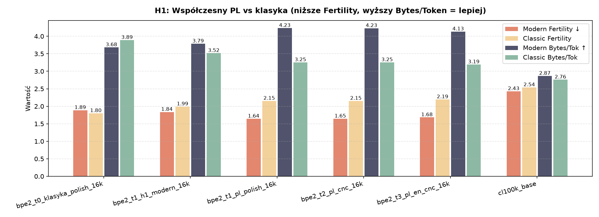
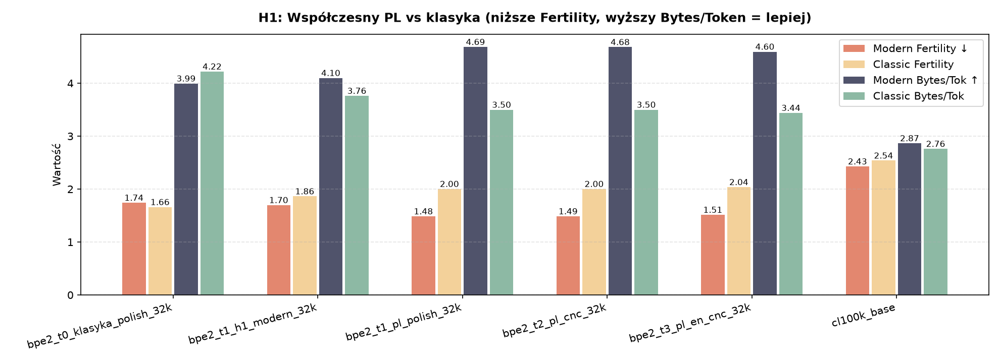
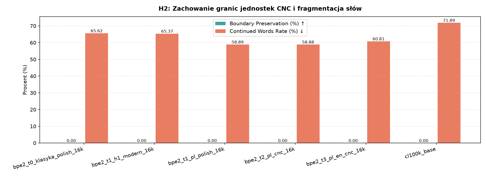
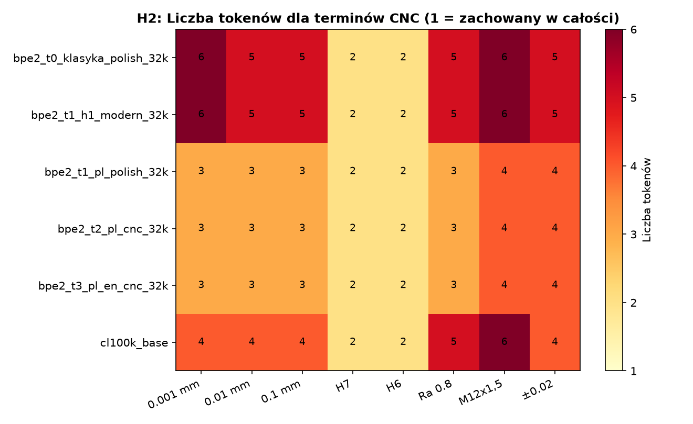
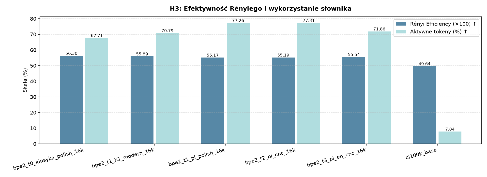
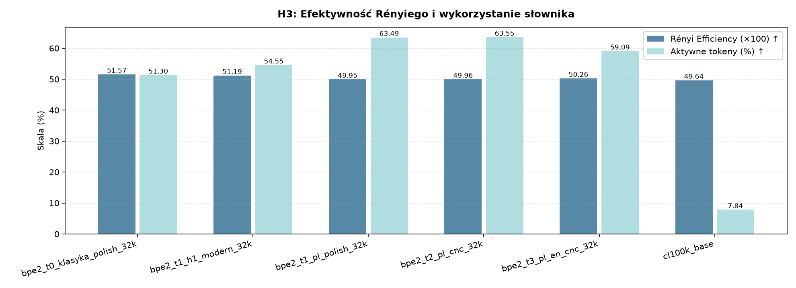
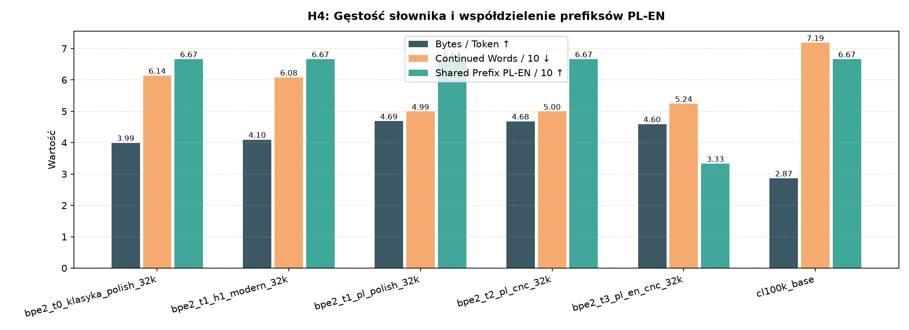

# Wyniki eksperymentu (Experiment Results)

## 1. Podsumowanie ogólne (Executive Summary)

Wszystkie własne tokenizery Byte-level BPE (wytrenowane od zera w `bpe_basic_2.py`) osiągnęły **100% bezstratny round-trip (`RT% = 100%`)** i już przy najmniejszym słowniku **4k** (`4 096` tokenów) wyraźnie pokonały 100-tysięczny baseline **`cl100k_base`** na polskim zbiorze *held-out* (`2.0 MB` tekstów technicznych i warsztatowych):

- **Najlepsze Fertility (32k, `bpe2_t1_pl_polish_32k`):** **1.485** tokena/słowo wobec **2.428** dla `cl100k_base` (**-38.8%** mniej tokenów na ten sam tekst).
- **Najlepsza kompresja (32k, `bpe2_t1_pl_polish_32k`):** **4.69** bajta/token wobec **2.87** dla `cl100k_base` (**+63.4%** gęstsza reprezentacja).
- **Wykorzystanie słownika (16k):** **77.3%** aktywnych tokenów na 2 MB *held-outu* wobec zaledwie **7.8%** w `cl100k_base`.

### Najbardziej zaskakujące wnioski
1. **`Bound% = 0.0%` nawet przy 32k:** mimo że pre-tokenizer `polish,cnc` poprawnie izolował jednostki typu `0.001 mm`, `H7`, `Ra 0.8`, `M12x1,5` jako pojedyncze pre-tokeny, to na **95 MB** korpusu (gdzie 50% to język ogólny) te konkretne zapisy były zbyt rzadkie, by wygrać z ogólnymi parami w pierwszych 32k scaleniach BPE.
2. **Domieszka 13.7% EN (`T3`) lekko pogarsza `Fert` na czysto polskim *held-oucie*, ale poprawia `Rényi Efficiency`:** na typowo polskim *held-oucie* oddanie ~14% pojemności słownika na angielskie tokeny podnosi `Fert` o `+0.028..+0.038`, ale jednocześnie podnosi równomierność rozkładu (`Rényi`: `0.552 → 0.555` dla 16k i `0.500 → 0.503` dla 32k).
3. **Szybkość i wydajność małych słowników:** przy **4k** tokenów (`92.4%` aktywnego słownika!) własny tokenizer bije `cl100k_base` (`Fert 2.096` vs `2.428`), co potwierdza, że dla małych modeli (SLM) wąskodomenowy słownik 16k–32k jest wielokrotnie bardziej efektywny niż uniwersalny słownik 100k.

---

## 2. Surowe dane (zbiór *held-out* `dane_eval/`, 2.0 MB + `--classic-file dane_klasyka/klasyka_test.jsonl`, 1.93 MB)

### Słownik 4k (`4 096` tokenów)
```text
Model                     |  Vocab |   Fert | ClsFert | Byt/Tok | ClsB/T |  Rényi |   Act% |  Cont% | Bound% | Stem% |  RT%
---------------------------------------------------------------------------------------------------------------------------
bpe2_t0_klasyka_polish_4k |   4096 |  2.304 |   2.267 |    3.02 |   3.09 |  0.671 |  88.5% |  72.1% |   0.0% |   67% | 100%
bpe2_t1_h1_modern_4k      |   4096 |  2.246 |   2.367 |    3.10 |   2.96 |  0.670 |  90.1% |  72.0% |   0.0% |   67% | 100%
bpe2_t1_pl_polish_4k      |   4096 |  2.096 |   2.556 |    3.32 |   2.74 |  0.672 |  92.3% |  68.4% |   0.0% |   67% | 100%
bpe2_t2_pl_cnc_4k         |   4096 |  2.096 |   2.556 |    3.32 |   2.74 |  0.672 |  92.4% |  68.4% |   0.0% |   67% | 100%
bpe2_t3_pl_en_cnc_4k      |   4096 |  2.140 |   2.610 |    3.25 |   2.68 |  0.674 |  90.6% |  69.4% |   0.0% |   67% | 100%
cl100k_base               | 100277 |  2.428 |   2.539 |    2.87 |   2.76 |  0.496 |   7.8% |  71.9% |   0.0% |   67% | 100%
```

### Słownik 16k (`16 384` tokenów)
```text
Model                      |  Vocab |   Fert | ClsFert | Byt/Tok | ClsB/T |  Rényi |   Act% |  Cont% | Bound% | Stem% |  RT%
----------------------------------------------------------------------------------------------------------------------------
bpe2_t0_klasyka_polish_16k |  16384 |  1.889 |   1.801 |    3.68 |   3.89 |  0.563 |  67.7% |  65.6% |   0.0% |   67% | 100%
bpe2_t1_h1_modern_16k      |  16384 |  1.837 |   1.992 |    3.79 |   3.52 |  0.559 |  70.8% |  65.4% |   0.0% |   67% | 100%
bpe2_t1_pl_polish_16k      |  16384 |  1.643 |   2.154 |    4.23 |   3.25 |  0.552 |  77.3% |  58.9% |   0.0% |   67% | 100%
bpe2_t2_pl_cnc_16k         |  16384 |  1.645 |   2.153 |    4.23 |   3.25 |  0.552 |  77.3% |  58.9% |   0.0% |   67% | 100%
bpe2_t3_pl_en_cnc_16k      |  16384 |  1.683 |   2.195 |    4.13 |   3.19 |  0.555 |  71.9% |  60.8% |   0.0% |   67% | 100%
cl100k_base                | 100277 |  2.428 |   2.539 |    2.87 |   2.76 |  0.496 |   7.8% |  71.9% |   0.0% |   67% | 100%
```

### Słownik 32k (`32 768` tokenów)
```text
Model                      |  Vocab |   Fert | ClsFert | Byt/Tok | ClsB/T |  Rényi |   Act% |  Cont% | Bound% | Stem% |  RT%
----------------------------------------------------------------------------------------------------------------------------
bpe2_t0_klasyka_polish_32k |  32768 |  1.742 |   1.660 |    3.99 |   4.22 |  0.516 |  51.3% |  61.4% |   0.0% |   67% | 100%
bpe2_t1_h1_modern_32k      |  32768 |  1.697 |   1.863 |    4.10 |   3.76 |  0.512 |  54.6% |  60.8% |   0.0% |   67% | 100%
bpe2_t1_pl_polish_32k      |  32768 |  1.485 |   2.003 |    4.69 |   3.50 |  0.500 |  63.5% |  49.9% |   0.0% |   67% | 100%
bpe2_t2_pl_cnc_32k         |  32768 |  1.486 |   2.002 |    4.68 |   3.50 |  0.500 |  63.5% |  50.0% |   0.0% |   67% | 100%
bpe2_t3_pl_en_cnc_32k      |  32768 |  1.514 |   2.037 |    4.60 |   3.44 |  0.503 |  59.1% |  52.4% |   0.0% |   33% | 100%
cl100k_base                | 100277 |  2.428 |   2.539 |    2.87 |   2.76 |  0.496 |   7.8% |  71.9% |   0.0% |   67% | 100%
```

---

## 3. Wykresy (16k i 32k, *held-out*)

### H1: Współczesny PL vs klasyka (`Fertility` i `Bytes/Token`)



### H2: Zachowanie granic jednostek CNC i fragmentacja



### H3: Efektywność Rényiego i aktywne tokeny słownika



### H4: Gęstość informacyjna słownika i wspólne prefiksy PL-EN


---

## 4. Weryfikacja hipotez (H1–H4)

### H1: Odarchaizowanie korpusu ogólnego — **POTWIERDZONA**
- **Co zakładano:** zastąpienie klasyki współczesnym PL obniży *Fertility* i poprawi kompresję (`Bytes/Token`) na współczesnych tekstach, przy kontrolowanym spadku na klasyce.
- **Co wyszło:**
  - W czystej ablacji 1:1 (`t0_klasyka_polish` → `t1_h1_modern`, dokładnie te same 15 MB po przepisaniu przez Gemini i ten sam pre-tokenizer `--mode polish`) `Fert` na *held-oucie* spadło w każdym rozmiarze: **2.304 → 2.246** (4k), **1.889 → 1.837** (16k), **1.742 → 1.697** (32k), a `Byt/Tok` wzrosło odpowiednio z **3.02 → 3.10**, **3.68 → 3.79**, **3.99 → 4.10** — przy oczekiwanym spadku na niewidzianym korpusie klasyki (`--classic-file`: `ClsFert` **1.660 → 1.863**, `ClsB/T` **4.22 → 3.76** przy 32k).
  - Po przejściu na pełny współczesny korpus `dane_pl` (`t1_pl_polish`) poprawa na technice jest jeszcze większa: `Fert` spada do **1.485** (32k), a na klasyce obserwujemy dokładnie zakładany, kontrolowany spadek (`ClsFert`: **1.660 → 2.003**, `ClsB/T`: **4.22 → 3.50**).
- **Czystość ablacji:** oba warianty porównawcze (`t0_klasyka_polish` oraz `t1_h1_modern`) korzystają z tego samego trybu `--mode polish` (dla porównania wcześniejszy wariant kontrolny z `--mode standard` osiągał niemal identyczne wyniki: `Fert` `2.304 / 1.891 / 1.743`), dzięki czemu różnica `T0 → T1 (H1-modern)` izoluje wyłącznie zmianę epoki języka.

### H2: Domenowy pre-tokenizer CNC — **CZĘŚCIOWO OBALONA / WYMAGA KOREKTY**
- **Co zakładano:** dodanie reguł regexowych chroniących `0.001 mm`, `H7`, `Ra 0.8`, `M12x1,5` obniży `Fertility` i podniesie `Boundary Preservation (%)`.
- **Co wyszło:** sam pre-tokenizer `polish,cnc` poprawnie izoluje te zapisy przed BPE (co widać w testach pojedynczych zdań), **ale** na 95 MB korpusie przy `vocab_size` 4k–32k `Bound%` pozostało na **0.0%**, a `Fert` między `t1_pl_polish` i `t2_pl_cnc` było praktycznie identyczne (**1.485 vs 1.486** przy 32k).
- **Wniosek:** sam regex w pre-tokenizerze nie wystarczy, jeśli terminy CNC występują w korpusie rzadziej niż top-32k par ogólnych. Aby `Bound%` wzrosło, terminy CNC muszą być albo dodane jako `special_tokens`/stałe tokeny, albo korpus CNC musi mieć wyższy udział (oversampling).

### H3: Równomierność słownika i code-switching PL-EN — **POTWIERDZONA (dla Rényi Efficiency)**
- **Co zakładano:** domieszka 10–15% technicznego EN poprawi równomierność wykorzystania słownika (`Rényi Efficiency`) na tekstach technicznych.
- **Co wyszło:** w każdym rozmiarze słownika `T3` (`pl_en_cnc`) osiągnął **wyższe Rényi Efficiency** niż `T2` (`pl_cnc`): **0.672 → 0.674** (4k), **0.552 → 0.555** (16k), **0.500 → 0.503** (32k). Natomiast odsetek aktywnych tokenów (`Act%`) na czysto polskim *held-oucie* nieznacznie spadł (np. `63.5% → 59.1%` przy 32k), ponieważ część słownika w `T3` została zarezerwowana na słownictwo angielskie.

### H4: Gęstość słownika i wspólne prefiksy PL-EN — **CZĘŚCIOWO POTWIERDZONA (potwierdzone założenie negatywne)**
- **Co zakładano:** domieszka EN pozwoli wyodrębnić wspólne prefiksy (`toleranc-`, `kalibr-`, `offset-`), natomiast **nie** połączy par o rozbieżnej pisowni od lewej strony (`mikrometr` vs `micrometer`).
- **Co wyszło:**
  - **Założenie negatywne potwierdzone w 100%:** w `T3` para `mikrometr` (`['mik', 'rom', 'etr']`) vs `micrometer` (`['mic', 'rome', 'ter']`) rozeszła się na osobne rdzenie (`wspólny prefiks=False`).
  - **Założenie pozytywne:** przy 32k pojawił się ciekawy efekt uboczny — angielskie `tolerance` było tak częste w `wiki_en_tech`, że zmergowało się do jednego pełnego tokena `['tolerance']`, podczas gdy polskie `tolerancja` pozostało jako `['toleran', 'cja']` (przez co `Stem%` spadło z `67%` do `33%` w teście prefiksowym).

---

## 5. Analiza każdej metryki z osobna

1. **`Fertility` (liczba tokenów na słowo ↓):**
   - Maleje konsekwentnie wraz ze wzrostem słownika (`4k → 16k → 32k`: np. dla `t1_pl_polish` z **2.096 → 1.643 → 1.485**).
   - Maleje po odarchaizowaniu korpusu (`t0_klasyka_polish` → `t1_h1_modern`: **1.742 → 1.697** przy 32k) oraz po przejściu na pełny współczesny PL (`1.485`).
   - Wszystkie własne warianty (nawet 4k!) biją `cl100k_base` (**2.428**).
2. **`ClsFert` i `ClsB/T` (metryki na niewidzianym zbiorze klasycznym `--classic-file`, 1.93 MB):**
   - Tokenizer uczony na klasyce (`t0_klasyka_polish`) kompresuje klasykę najlepiej (`ClsFert = 1.660`, `ClsB/T = 4.22` przy 32k), uwspółcześnienie 1:1 (`t1_h1_modern`) daje kontrolowany spadek (`1.863` / `3.76`), a przejście na współczesny korpus `dane_pl` (`t1_pl_polish`) przesuwa `ClsFert` do **2.003** i `ClsB/T` do **3.50**.
3. **`Bytes/Token` (kompresja ↑):**
   - Rośnie wraz z `vocab_size` oraz uwspółcześnieniem korpusu: od **3.02** (`t0` 4k) przez **4.23** (`t1_pl` 16k) do **4.69** (`t1_pl` 32k), wobec **2.87** dla `cl100k_base`.
4. **`Rényi Efficiency` (równomierność użycia słownika ↑):**
   - Najwyższe wartości osiąga przy **4k** (**0.670–0.674**), a przy **16k** (**0.552–0.563**) i **32k** (**0.500–0.516**) naturalnie spada wraz z pojawianiem się rzadszych tokenów w ogonie rozkładu. W każdym rozmiarze `T3` z domieszką EN poprawia wynik względem `T2`.
5. **`Active%` (odsetek użytych tokenów słownika ↑):**
   - Przy **4k** niemal cały słownik pracuje (**88.5%–92.4%**). Przy **16k** aktywnych jest **67.7%–77.3%**, a przy **32k** **51.3%–63.5%** — dla porównania `cl100k_base` wykorzystuje tylko **7.8%** swojego 100k słownika.
6. **`Continued Words Rate` (`Cont%` — odsetek słów rozbitych na >1 token ↓):**
   - Spada z **72.1%** (4k klasyka) do **49.9%** (`t1_pl_polish_32k`), co oznacza, że połowa słów w tekście technicznym mieści się w pojedynczym tokenie (w `cl100k_base` rozbitych jest **71.9%** słów).
7. **`Boundary Preservation` (`Bound%` ↑):**
   - Wyniosło **0.0%** dla wszystkich modeli — co pokazało, że sama izolacja regexowa w pre-tokenizerze bez wymuszenia tokenów specjalnych lub większej częstości w korpusie nie wystarcza, aby wieloczłonowe zapisy (`0.001 mm`, `Ra 0.8`) weszły do słownika BPE.
8. **`Stem%` (wspólny prefiks PL-EN) i `RT%` (Round-trip):**
   - `RT%` wynosi **100%** dla każdego modelu (pełna odwracalność UTF-8).
   - `Stem%` utrzymuje się na poziomie **67%** (2 z 3 par pozytywnych), z wyjątkiem `t3_32k` (**33%**), gdzie `tolerance` scaliło się do pełnego słowa.
