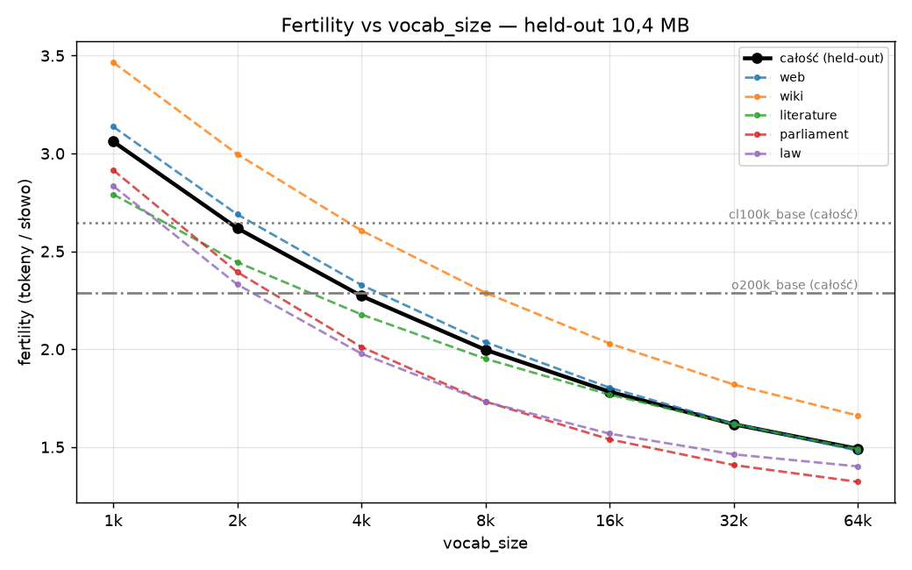
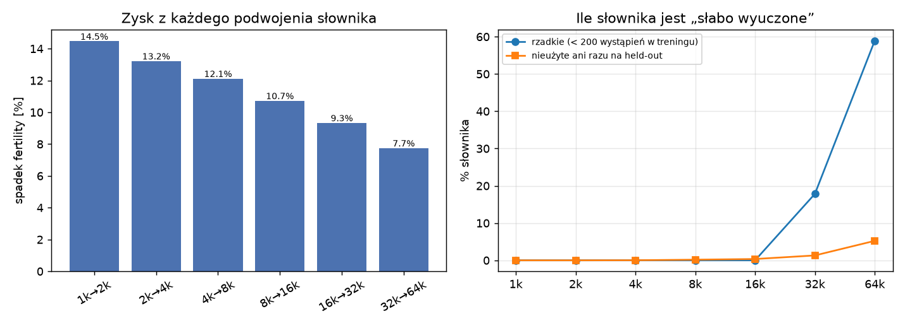
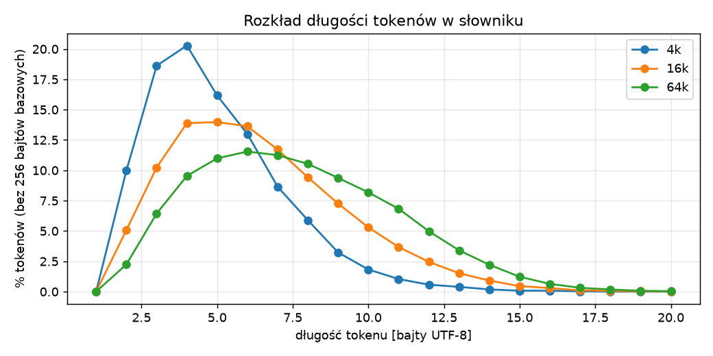
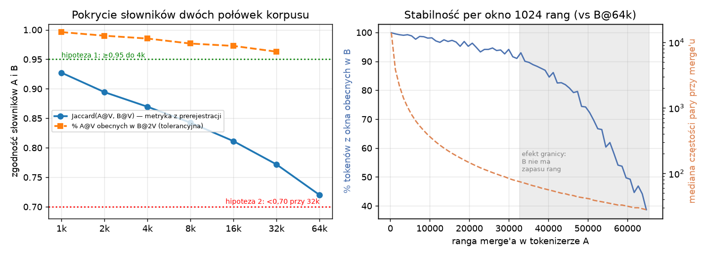
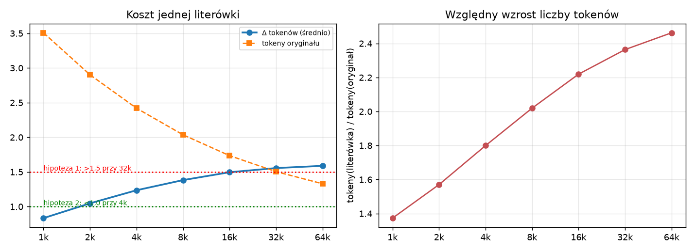
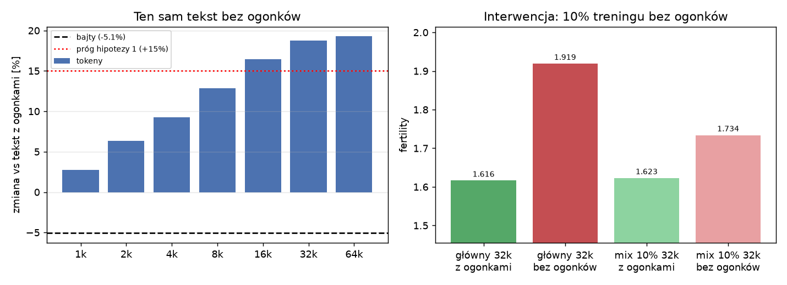
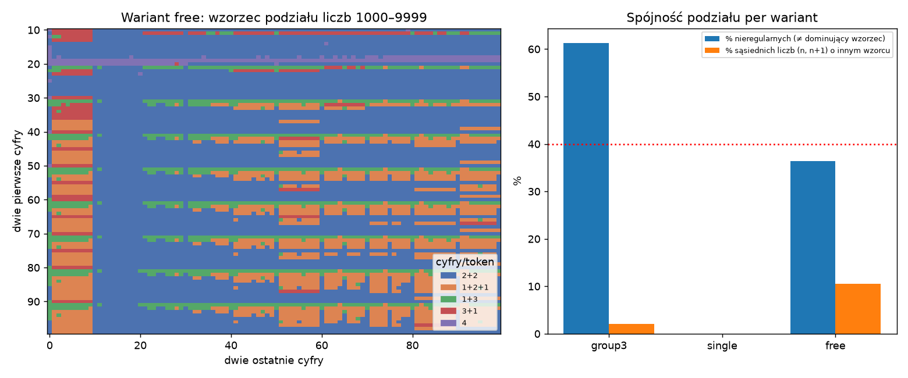

# Polski tokenizer BPE: korpus, vocab_size i cztery pytania badawcze

Byte-level BPE w czystym Pythonie (`src/bpe/`). Trener działa według algorytmu z warsztatu,
z przyrostowymi licznikami par; jego zgodność z naiwną implementacją sprawdziłem testem.
Wszystkie metryki liczę **wyłącznie na held-out** (10,4 MB dokumentów, które nie trafiły
do treningu). Hipotezy spisałem **przed** treningiem
([`PREREGISTRATION.md`](PREREGISTRATION.md)).

Definicje metryk:
- **fertility** = tokeny / słowa, gdzie słowo to segment rozdzielony białym znakiem;
- **compression** = bajty UTF-8 / token.

---

## 1. Korpus

**Domena: ogólna polszczyzna pisana i mówiona-urzędowa.** Różnorodność zapewnia
pięć rejestrów, a nie jedno źródło:

| Źródło | Licencja / podstawa | Surowe | Train | Held-out |
|---|---|---:|---:|---:|
| Web: FineWeb-2 `pol_Latn` (losowa próbka) | ODC-By 1.0 | 75,0 MB | 70,5 MB (41%) | 3,8 MB |
| Wikipedia PL (zrzut 2023-11, losowe artykuły z 1 shardu) | CC BY-SA 3.0 | 35,0 | 31,1 (18%) | 2,0 |
| Wolne Lektury (635 losowych utworów) | domena publiczna / CC BY-SA | 30,4 | 26,6 (15%) | 2,2 |
| Wystąpienia w Sejmie, kadencje VII–X | art. 4 pkt 2 pr. aut. + ustawa o otwartych danych | 30,0 | 20,9 (12%) | 1,1 |
| Akty prawne Dz.U. 2020–2025 (API ELI Sejmu) | art. 4 pkt 1 pr. aut. | 25,1 | 22,6 (13%) | 1,2 |
| **Razem** | | **195,5** | **171,8 MB** | **10,4 MB** |

**Pipeline czyszczenia** (`scripts/clean.py`, statystyki w `data/clean/stats.json`):

1. **Normalizacja.** Unicode NFC, bo w NFD „ą” to inne bajty i BPE nauczyłoby się
   dwóch wersji. Usuwam też znaki sterujące i nadmiarowe białe znaki.
2. **Czyszczenie specyficzne dla źródeł.**
   - Wolne Lektury: stopki licencyjne (ok. 1,4 MB).
   - Sejm: doklejony metadanych trailer „Przebieg posiedzenia…” (ok. 8 MB, czysty szum
     powtarzany w każdej wypowiedzi) i didaskalia typu „(Oklaski)”.
   - Prawo: twarde łamania linii z układu PDF oraz napisy z UI.
3. **Boilerplate w webie.** Linie występujące w ≥ 5 różnych dokumentach (0,46 MB).
4. **Filtry jakości.**
   - za krótkie, < 300 znaków (1,5 MB, głównie zalążki Wikipedii);
   - mało liter (0,2 MB, tabele w aktach prawnych);
   - mojibake (0,1 MB, np. „wi臋kszy”, czyli polski tekst odczytany jako GBK);
   - „nie po polsku” (0,26 MB, m.in. niemieckie przekłady „Trenów”, strony z hazardem
     po indonezyjsku).

   Pierwsza wersja filtra językowego (≥ 12% stop-słów) **odrzucała poprawną polszczyznę**,
   np. biogramy i ogłoszenia. Poluzowałem ją po ręcznym przeglądzie odrzutów.
5. **Deduplikacja.**
   - dokładna (hash tekstu);
   - **zawieranie**: dokument, którego > 50% długich akapitów już widziano, wylatuje,
     co łapie m.in. teksty jednolite ustaw (1,1 MB);
   - MinHash LSH (Jaccard ≥ 0,8).
6. **Podział train/held-out** po dokumentach (5% z każdego źródła, hash ID), wykonany
   **po** deduplikacji całości. Dzięki temu żaden akapit z held-out nie występuje
   w treningu.

**Znane skrzywienia:**
- **Web** to ponad 40% korpusu, więc dominuje: handel, SEO, ogłoszenia.
- **Wikipedia** pochodzi z jednego shardu (nowsze artykuły), z dużą ilością biogramów
  sportowców i nazw obcych.
- **Literatura** to głównie XIX i początek XX wieku: archaizmy i stare przekłady.
- **Brakuje**: mowy potocznej, mediów społecznościowych, kodu i angielskiego.
- **Web zawiera trochę polszczyzny „bez ogonków”** (np. „Kupilem bilet…”). To realne
  zjawisko i je zostawiłem (patrz pytanie 3.3).

**Przewidywania (spisane przed treningiem) a wynik:**

| # | Przewidywanie | Wynik | Werdykt |
|---|---|---|---|
| 1 | Słownictwo webowe dostanie tokeny wcześniej niż literackie | „ produktu” #5206, „ oferta” #10066 vs „ rzekł” #3140, „ pani” #1446 | ✗ |
| 2 | Prawo kupi tokeny ponad udział; **najniższa** fertility | „ poz” #611, „ ust” #627, „ ustawy” #712 (top 1k–2k); najniższa fertility tylko w zakresie 2k–8k, wyżej wygrywa **Sejm** (1,41 vs 1,46 przy 32k) | ½ |
| 3 | Literatura ma najwyższą fertility | najwyższą ma **Wikipedia** (1,82 przy 32k; nazwy obce, liczby), literatura = średnia | ✗ |
| 4 | Sejm dostanie tokeny formułkowe | „ Panie” #1834, „ Wysoka” #1957, „ Izbo” #1992, „ Marszałku” #2570 | ✓ |
| 5 | Fertility przy 32k ≈ 1,55–1,70 | **1,616** | ✓ |

**Wniosek do korpusu.** O wczesnych rangach decyduje **powtarzalność rejestru**, a nie
jego udział w danych. Formułki z Sejmu i prawa (razem 25% danych) wyprzedzają słownictwo
webu (41%). Wikipedia jest najtrudniejsza, bo jest najbardziej różnorodna leksykalnie.

---

## 2. Vocab size

Jeden trening do 65 536. Mniejsze tokenizery są **prefiksami** listy merge'ów: algorytm
jest zachłanny i nie zależy od docelowego rozmiaru, co sprawdza test `test_prefix_property`.
Trening trwa ok. 3,5 minuty na 172 MB.

| vocab | fertility | bajty/token | zysk vs V/2 | merge'e < 200 wystąpień w treningu | nieużyte na held-out |
|---:|---:|---:|---:|---:|---:|
| 1k | 3,061 | 2,41 | — | 0 | 0 |
| 4k | 2,272 | 3,24 | 13,2% | 0 | 1 |
| 8k | 1,997 | 3,69 | 12,1% | 0 | 14 |
| 16k | 1,783 | 4,13 | 10,7% | 0 | 58 (0,4%) |
| **32k** | **1,616** | **4,56** | 9,3% | 5 842 (18%) | 430 (1,3%) |
| 64k | 1,491 | 4,94 | 7,7% | 38 610 (**59%**) | 3 425 (5,2%) |
| *cl100k_base* | *2,647* | | | | |
| *o200k_base* | *2,287* | | | | |

**Obserwacje:**
- **Nie ma wyraźnego „kolana”.** Każde podwojenie daje stopniowo mniej: od 14,5% do 7,7%.
  Moje przewidywanie kolana przy 16–32k się nie potwierdziło, bo spadek jest płynny.
- **Koszt rośnie skokowo.** Przy 16k każdy token wystąpił w treningu ≥ 396 razy.
  Przy 64k 59% tokenów ma < 200 wystąpień (ostatnie merge'e: 56 wystąpień na 172 MB),
  a 5,2% nie pojawia się ani razu w 10 MB held-out. Przewidywałem > 2% nieużytych przy 64k
  i to się potwierdziło.
- **Rozkład długości tokenów** przesuwa się w prawo: średnio 5,0 B przy 4k, 7,1 B przy 32k,
  7,7 B przy 64k. Duże słowniki dokładają głównie całe formy fleksyjne
  (np. „ odbierają”, „ biegał”).
- **Porównanie z tiktoken.** Nasz 4k (fertility 2,27) dorównuje **o200k_base** (2,29)
  na polskim tekście, a 32k zużywa o 39% mniej tokenów niż cl100k_base. To ten sam
  mechanizm co w przypadku Bielika APT4: dopasowanie do języka bije rozmiar słownika.

**Rekomendacja: 32k** dla tokenizera trenowanego na korpusie tej wielkości. Uzasadnienie
z moich pomiarów:

1. **Zysk 32k→64k to tylko 7,7% krótszych sekwencji.** Kosztuje dodatkowe 32k wierszy
   embeddingów (+134 M parametrów przy d = 4096, dwa razy tyle przy niewiązanej głowie
   wyjściowej).
2. **Powyżej ok. 32k słownik przestaje być powtarzalny** (pytanie 3.1). Tokeny z rang
   > 32k w ponad 10–25% nie powstają na innej próbce tego samego rozkładu, więc są
   artefaktem próbki, a nie właściwością języka. Mają też < 150 wystąpień, czyli model
   zobaczy je rzadko.
3. **Odporność na literówki praktycznie nie pogarsza się powyżej 16k** (pytanie 3.2), więc
   nie jest to argument przeciw 32k.

**Zastrzeżenie.** Granica nie wynika z magii liczby 32k, tylko z ilości danych
tokenizera. Moja reguła: rosnąć, dopóki ostatnie merge'e mają ≥ ok. 150 wystąpień
i dwie połówki korpusu zgadzają się w ≥ 90%. Przy 1 GB danych ta reguła prawdopodobnie
wskazałaby 64k.

---

## 3. Pytania badawcze

### 3.1 Stabilność słownika: od której rangi merge'e to szum próbkowania?

- **Hipoteza (prerejestracja):** Jaccard słowników z dwóch rozłącznych połówek korpusu
  ≥ 0,95 do 4k (hipoteza 1) i < 0,70 przy 32k (hipoteza 2).
- **Metoda:** dwa tokenizery do 64k na losowych połówkach (podział po dokumentach,
  po 86 MB).

**Wynik:**
- Jaccard wynosi 0,927 przy 1k, 0,870 przy 4k, 0,772 przy 32k i 0,720 przy 64k.
  **Hipoteza 1 obalona** (już przy 1k < 0,95). **Hipoteza 2 obalona** (0,77 przy 32k).
- Analiza rozbieżności przy 1k: 28 z 29 „brakujących” tokenów istnieje w drugim
  tokenizerze, tylko kilka rang dalej (mediana rangi 1064 vs granica 1024). **Zła była
  metryka:** Jaccard przy tym samym V mierzy głównie przesunięcia wokół granicy cięcia.
- Metryka tolerancyjna (dodana po fakcie i tak oznaczona): odsetek tokenów A@V obecnych
  w B@2V. Wynosi 99,6% przy 1k, 98,5% przy 4k, 97,3% przy 16k i 96,3% przy 32k.
- W oknach rang (prawy wykres) pokrycie spada poniżej 90% dopiero za rangą ok. 32k.
  Tam mediana częstości pary w połówce korpusu spada poniżej ok. 75.

**Wniosek:**
- Słownik jest **znacznie stabilniejszy**, niż zakładałem: przy 32k tylko ok. 4% tokenów
  to przypadek próbki.
- Niestabilność nie ma progu, tylko rośnie płynnie i przyspiesza, gdy częstość merge'a
  spada poniżej ok. 100–150 wystąpień.
- Lekcja metodologiczna: porównanie słowników „na tym samym V” systematycznie zaniża
  ich zgodność.

### 3.2 Ile kosztuje jedna literówka i czy duży słownik jest bardziej kruchy?

- **Hipoteza:** średnie Δ tokenów > 1,5 przy 32k (hipoteza 1), < 1,0 przy 4k (hipoteza 2), Δ rośnie
  z vocab_size (hipoteza 3).
- **Metoda:** 20 000 słów (≥ 4 litery) z held-out, ważonych częstością, każde z jedną
  losową literówką (zamiana, usunięcie, wstawienie, sąsiedni klawisz).

| | 1k | 4k | 16k | 32k | 64k |
|---|---:|---:|---:|---:|---:|
| Δ tokenów | 0,83 | 1,24 | 1,50 | **1,56** | 1,59 |
| tokeny(literówka) / tokeny(oryginał) | 1,37× | 1,80× | 2,22× | 2,36× | 2,46× |
| słowa jako 1 token | 7% | 25% | 51% | 65% | 76% |

**Wynik:**
- **Hipoteza 1 potwierdzona**, ale minimalnie (1,56 > 1,5).
- **Hipoteza 2 obalona**: 1,24 przy 4k, a próg 1,0 przekraczamy już przy 2k.
- **Hipoteza 3 potwierdzona**: Δ rośnie monotonicznie.
- Nieoczekiwane: **bezwzględny koszt nasyca się** (16k→64k: +0,09 tokenu), a rośnie
  głównie koszt **względny**. Przy 32k słowo z literówką jest średnio 2,4× dłuższe
  i przestaje przypominać oryginał.

**Wniosek:** duży słownik nie jest bardziej kruchy w liczbie dodatkowych tokenów, tylko
w **reprezentacji**. Literówka zamienia jeden znany token w 2–3 „obce” fragmenty. Dla
korpusów z dużą ilością literówek (fora, czaty) przemawia to za augmentacją danych,
a nie za mniejszym słownikiem.

### 3.3 Polski „bez ogonków”

- **Hipoteza:** po usunięciu diakrytyków bajty spadają o ok. 3%, a tokeny rosną o > 15%
  przy 32k (hipoteza 1). Domieszka 10% tekstu bez ogonków w treningu odzyskuje > 50% straty
  kosztem < 2% fertility na normalnym tekście (hipoteza 2).

**Wynik:**
- Bajty spadają o **5,1%**, więc moje przewidywanie (3%) było niedoszacowane: polskie
  litery to 5% bajtów tekstu.
- Tokeny rosną o **18,7%** przy 32k. **Hipoteza 1 potwierdzona.**
- Kara rośnie z rozmiarem słownika: +2,8% przy 1k, +19,3% przy 64k. Duży słownik
  zapamiętał formy z ogonkami, a formy bez nich trafiają w nic.
- Interwencja: domieszka 10% odzyskuje **61%** straty (fertility 1,919 → 1,734)
  kosztem **0,4%** na normalnym tekście (1,616 → 1,623). **Hipoteza 2 potwierdzona.**

**Wniosek:** 10% augmentacji „bez ogonków” to niemal darmowe ubezpieczenie dla
tokenizera, który ma obsługiwać tekst z internetu. Strata nie znika jednak w całości,
bo formy bez ogonków konkurują o te same miejsca w słowniku.

### 3.4 Liczby: jak pretokenizacja cyfr zmienia ich podział?

- **Hipoteza:** w wariancie `free` (`\p{N}+`) ponad 40% liczb 4-cyfrowych ma
  nieregularny podział (hipoteza 1), lata 1950–2025 to ≥ 90% pojedynczych tokenów (hipoteza 2), a wybór
  wariantu cyfr zmienia fertility o < 1% (hipoteza 3).
- **Metoda:** trzy tokenizery 32k różniące się tylko obsługą cyfr:
  - `group3` (GPT-4: grupy ≤ 3 cyfr od lewej);
  - `single` (każda cyfra osobno);
  - `free` (BPE decyduje samo).

| wariant | wzorce podziału 1000–9999 | % nieregularnych | lata 1950–2025 = 1 token | tokeny/liczbę (held-out) | fertility | Δ vs group3 |
|---|---|---:|---:|---:|---:|---:|
| group3 | 1+2+1 / 2+1+1 / 3+1 | **61%** | 0% | 1,31 | 1,616 | — |
| single | 1+1+1+1 | 0% | 0% | 2,30 | 1,654 | **+2,4%** |
| free | 2+2 (64%), 1+2+1, 1+3, 3+1, 4 | 36% | **100%** | 1,08 | 1,608 | −0,5% |

**Wynik:**
- **Hipoteza 1 obalona** (36% < 40%). W wariancie `free` BPE samo „wymyśliło” spójny podział 2+2.
  Mapa pokazuje strukturę: lata 19xx–20xx są jednym tokenem, a 1+2+1 dotyczy głównie
  liczb kończących się na 00–09 oraz poziomych pasów dla wybranych setek.
- **Hipoteza 2 potwierdzona** (100%).
- **Hipoteza 3 obalona**: `single` kosztuje +2,4% tokenów na całym tekście.
- Największe zaskoczenie: **wzorzec GPT-4 (`group3`) jest najmniej regularny** (61%).
  Dzieli „1847” na „184|7”, czyli od lewej, wbrew grupowaniu tysięcy, a 3-cyfrowe grupy
  i tak nie mieszczą się w 32k (w słowniku jest tylko 312 tokenów cyfrowych).

**Wniosek:**
- Na polskim tekście z dużą liczbą dat i numerów aktów `free` daje najkrótsze sekwencje
  i spójne lata, ale wydaje na liczby 450 tokenów słownika.
- `single` jest jedynym w pełni spójnym wariantem (ważne dla arytmetyki) za cenę 2,4%
  dłuższych sekwencji.
- `group3` łączy wady obu: nie jest ani najkrótszy, ani spójny.
- Mój wybór dla polskiego LLM: `single`. Spójność cyfr kosztuje mniej niż 1/3 zysku
  z podwojenia słownika.

---

## Pułapka UTF-8: tak, tokenizer tnie znaki

BPE działa na bajtach, a regex wyznacza wyłącznie granice. Polskie litery scalają się
**bardzo wcześnie**: „ł” to merge nr 3, a „ę”, „ą”, „ó”, „ż”, „ś” mieszczą się
w pierwszych 25. Wielkie litery wchodzą później („Ź” dopiero na #25688).

Przy 32k w słowniku jest **29 tokenów niebędących poprawnym UTF-8**, czyli fragmentów
znaków. Dla „Źródła” na początku linii (nagłówek sekcji Wikipedii) tokenizer zwraca
`<c5>` + `<b9>ródła`, rozcinając „Ź” w połowie. Emoji 😀 to 3 tokeny-fragmenty.
Roundtrip jest bezstratny (sprawdzany na held-out przy eksporcie do HF), ale dekodowanie strumieniowe token po tokenie musi
buforować niepełne sekwencje bajtów.
